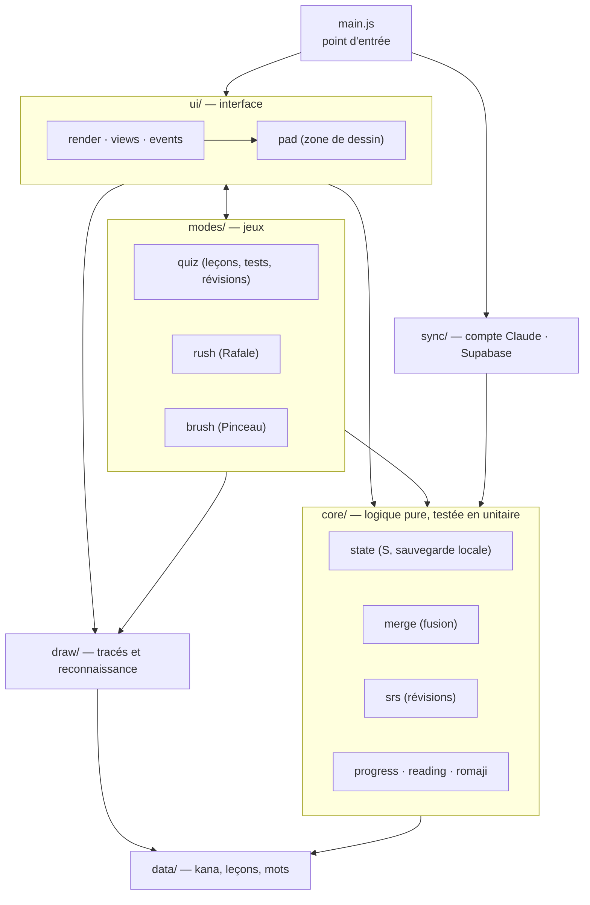
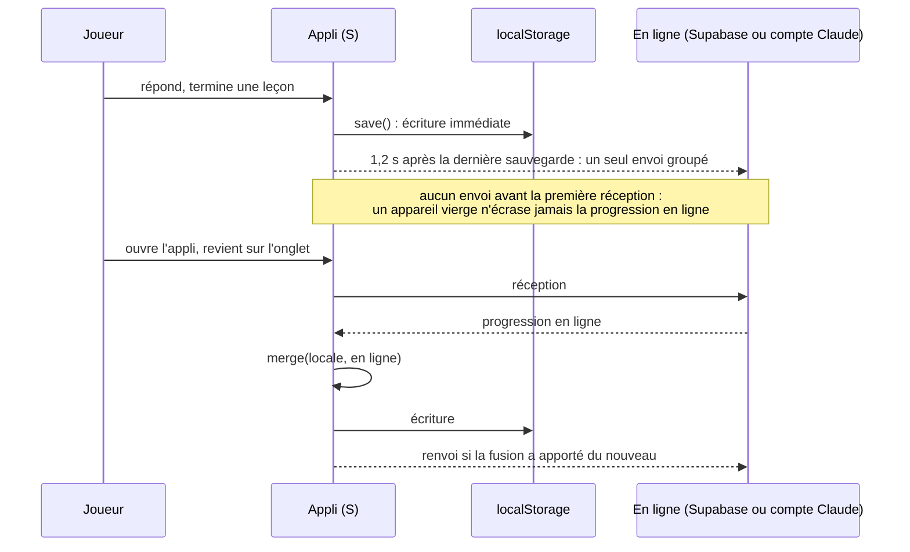
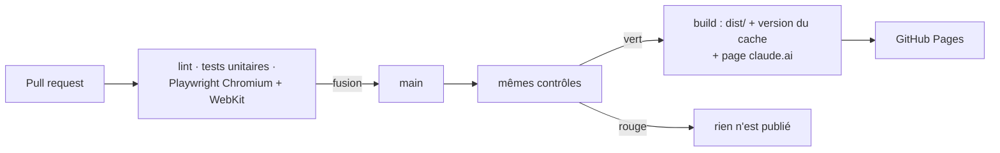

# Hanko · kana

[](https://github.com/Rouuulien/Hanko-kana/actions/workflows/deploy.yml)
[](https://github.com/Rouuulien/Hanko-kana/actions/workflows/test.yml)

Jeu web pour apprendre les hiragana et katakana, avec Daru le daruma comme guide. Application installable (PWA), jouable hors ligne, avec sauvegarde synchronisée entre appareils.

**Jouer : https://rouuulien.github.io/Hanko-kana/**

## Contenu du jeu

- **Parcours** : 208 kana en 6 unités (bases, sons voisés, combinaisons), leçons avec fiches de découverte puis quiz, test de fin d'unité (80 % pour obtenir le tampon).
- **Révisions espacées** : chaque kana revient de 4 h à 35 jours selon tes réponses (boîtes de Leitner).
- **Tableau** : grille des kana colorée selon ta maîtrise, touche un kana pour l'entendre.
- **Mots** : environ 175 mots courants qui se débloquent quand tu connais tous leurs kana.
- **Rafale** : mode vitesse en cartes avec clavier AZERTY intégré, en paquet complet ou contre la montre.
- **Écriture** : ordre des traits animé et tracé guidé dans les fiches, exercices « dessine ce kana » dans les quiz, et mode **Pinceau** (on reçoit le son, on dessine le kana ; reconnaissance du tracé, de l'ordre et du sens des traits).
- **Sons**, série de jours, XP.

Installer sur iPhone : ouvrir l'adresse dans Safari → Partager → « Sur l'écran d'accueil ». Sur Android : menu de Chrome → « Installer l'application ».

## Architecture

Application statique en JavaScript natif : **modules ES chargés directement par le navigateur, sans framework, sans dépendance à l'exécution et sans étape de compilation**. `index.html` n'est qu'une coquille qui charge `src/main.js`.

```
index.html            coquille de la page            sw.js        service worker (hors ligne)
styles.css            styles                         data/        tracés des kana (KanjiVG)
src/
├── main.js           point d'entrée : charge la progression, branche la synchro, premier affichage
├── data/             kana, unités et leçons · astuces · mots                         (données pures)
├── core/             état et sauvegarde locale · fusion · révisions espacées ·
│                     progression · mots lisibles · romaji                             (logique pure, sans DOM)
├── draw/             chargement des tracés · reconnaissance du tracé · SVG animés
├── sync/             synchronisation en ligne (compte Claude ou Supabase)
├── ui/               rendu · écrans · événements · zone de dessin · voix · sons · mascotte
└── modes/            leçons et quiz · Rafale · Pinceau
types/hanko.d.ts      types de la sauvegarde et des données (vérifiés par tsc, voir plus bas)
scripts/              construction du site publié et de la version claude.ai
tests/                tests unitaires (Node) et de bout en bout (Playwright)
```

Les dépendances vont des couches hautes vers les couches basses. Le cœur ne connaît ni le DOM ni l'interface : la synchronisation reçoit les quelques fonctions d'interface dont elle a besoin par injection (`bindUI`), ce qui la rend testable seule.



### Sauvegarde et synchronisation

La progression tient dans un seul objet `S` (type `State`, `types/hanko.d.ts`). Elle est toujours écrite d'abord sur l'appareil, puis envoyée en ligne. À la connexion, et chaque fois qu'on revient sur l'onglet, la version en ligne est **fusionnée** avec la locale, sans rien perdre : union des kana appris (la meilleure boîte l'emporte), des leçons, meilleurs scores et records, XP maximale.



Le format de sauvegarde n'évolue que par ajout de champs, avec une valeur par défaut, et la clé `hanko-kana-v1` ne change jamais. Les trois formats successifs de l'historique se chargent sans perte : des tests le vérifient.

### Hors ligne et mises à jour

Le service worker sert les fichiers du site **réseau d'abord**, avec revalidation, et le cache seulement hors ligne. Une page à jour n'est donc jamais servie avec d'anciens modules restés en cache : avec des modules séparés, ce mélange donnerait une page blanche. À la publication, `scripts/build.mjs` remplit le service worker avec la liste des fichiers publiés et une **version de cache égale à l'empreinte de leur contenu** : tout changement publié invalide le cache, et rien ne s'incrémente à la main.

## Choix techniques

| Choix | Raison |
|---|---|
| Modules ES natifs, sans framework ni compilation | Une application de cette taille (environ 2 800 lignes) n'a pas besoin d'outillage à l'exécution. Le code publié est le code source : rien à reconstruire pour déboguer en production, aucune dépendance à maintenir côté joueur. |
| Une seule exception : esbuild pour la version claude.ai | Une page claude.ai doit être autonome. `npm run build:claude` assemble les modules en un script unique. Le site GitHub Pages, lui, reste sans compilation. |
| Typage par JSDoc, vérifié par TypeScript (`tsc`) | Les bénéfices du typage sur la logique critique (sauvegarde, fusion, révisions) sans étape de compilation : `tsc` ne fait que vérifier. |
| Objet d'état unique `S`, jamais réaffecté | Un module ne peut pas réaffecter une variable qu'il importe. Les remplacements complets passent par `replaceState()`, qui garde le même objet. |
| Un seul écouteur de clics délégué (`data-act`) | L'interface est reconstruite en HTML à chaque rendu : aucun écouteur à rebrancher sur les éléments. |
| Supabase (Postgres, Row Level Security) | Comptes et sauvegarde en ligne sans serveur à maintenir. Seule la clé publique est dans le code ; la sécurité repose sur les règles d'accès (`supabase/schema.sql`). Données hébergées dans l'UE. |
| Polices hébergées avec l'appli, réduites aux caractères affichés | Une police japonaise complète pèse plusieurs mégaoctets. Les sous-ensembles (`npm run fonts`) tiennent en 870 Ko pour les trois familles et restent disponibles hors ligne ; un test vérifie que tout caractère du jeu est couvert. |
| Reconnaissance du tracé maison | Comparaison de nuages de points normalisés, puis trait par trait (forme, sens, ordre), contre tous les kana de la même écriture. Aucun modèle ni service externe : fonctionne hors ligne. |

## Qualité

**Tests.** 30 tests unitaires (Node, sans dépendance) et 83 tests navigateur (Playwright) : 49 tests de la logique dans la page et 34 parcours de bout en bout, joués sur Chromium et sur iPhone 13 / WebKit. Ils tournent à chaque PR et avant chaque déploiement.

- **Écrits avant la refonte, sur le code d'origine**, comme tests de caractérisation. L'ancien fichier unique a ensuite été découpé en modules PR par PR, sous ces tests, sans changer leurs attentes. Une seule référence a été réenregistrée, sur le code encore intact, quand le générateur de tracés est devenu reproductible hors navigateur. Seul un adaptateur (`tests/helpers/hook.mjs`) change quand le code se réorganise.
- **Données réelles** : une vraie sauvegarde de joueur, anonymisée (dates décalées, aucun identifiant), et les anciens formats reconstitués depuis l'historique git.
- **Références enregistrées** : lectures des 208 kana et des mots, et 834 jugements de la reconnaissance sur des tracés de synthèse à graine fixe.
- **Propriétés** : 2 000 paires de sauvegardes aléatoires, pour vérifier que la fusion ne perd rien et ne dépend pas de l'ordre.
- **Parcours complets pilotés comme un joueur** : leçon, révisions, Rafale au clavier, Pinceau dessiné au pointeur. Synchronisation avec de faux Supabase et compte Claude, hors ligne, et mise à jour d'une version à l'autre.
- **Vérifiés par mutation** : des bugs introduits volontairement (garde de synchronisation retirée, seuil de reconnaissance modifié, service worker « cache d'abord »…) font échouer les tests correspondants.

**Style et types.** ESLint, Prettier et `tsc` (`npm run lint`) bloquent la CI.

**Déploiement continu.** Chaque push sur `main` lance les tests, construit `dist/` et publie sur GitHub Pages. Si un test échoue, rien n'est publié.



## Développement

Jouer en local ne demande aucune installation : `python3 -m http.server`, puis `http://localhost:8000`. Les outils (tests, style, build) demandent Node 22 :

```sh
npm ci && npx playwright install chromium
npm test                 # tests unitaires puis navigateur
npm run lint             # ESLint, Prettier, types
npm run format           # reformate le code
npm run build            # dist/ : le site tel que publié
npm run build:claude     # dist-claude/ : version claude.ai autonome
```

Détails des tests : [`tests/README.md`](tests/README.md). Règles du projet, notamment pour ne jamais faire perdre la progression : [`CLAUDE.md`](CLAUDE.md).

## Comptes et sauvegarde

Deux versions du même code :

- **GitHub Pages / appli installée** : progression sur l'appareil et, si l'on est connecté, sur un compte Supabase. Connexion par **e-mail + mot de passe** (méthode principale, fonctionne dans tous les navigateurs et dans l'appli installée) ou par **lien / code par e-mail**. Mot de passe oublié et définition d'un mot de passe depuis un appareil connecté sont gérés.
- **claude.ai** : progression sauvegardée automatiquement sur le compte Claude.

Dans tous les cas, *Réglages → Sauvegarde → Copier le code* donne un code de secours à *Importer* ailleurs.

### Mise en place de Supabase

Deux façons de se connecter : **e-mail + mot de passe** (méthode principale, fonctionne dans tous les navigateurs et dans l'appli installée) ou **lien / code par e-mail**. Mot de passe oublié et définition d'un mot de passe depuis un appareil connecté sont gérés. La progression est gardée sur l'appareil et synchronisée avec Supabase.

Mise en place, une seule fois :

1. **Base de données** : Supabase → *SQL Editor* → coller le contenu de `supabase/schema.sql` → *Run*.
2. **Adresses autorisées** : *Authentication → URL Configuration* :
   - *Site URL* : `https://rouuulien.github.io/Hanko-kana/`
   - *Redirect URLs* : ajouter `https://rouuulien.github.io/Hanko-kana/**`
3. **E-mail avec code** (nécessite un SMTP personnalisé, voir point 4) : *Authentication → Emails → Magic Link*. Remplacer le contenu par :
   - Sujet : `Ton code de connexion Hanko`
   - Corps :
     ```html
     <h2>Ton code Hanko</h2>
     <p>Saisis ce code dans l'appli pour te connecter :</p>
     <p style="font-size:28px;font-weight:bold;letter-spacing:4px">{{ .Token }}</p>
     <p>Ou clique ici : <a href="{{ .ConfirmationURL }}">me connecter</a></p>
     <p>Si tu n'as rien demandé, ignore cet e-mail.</p>
     ```
   Le code est indispensable sur iPhone : une appli installée sur l'écran d'accueil ne partage pas sa session avec Safari, donc le lien ouvrirait le jeu dans Safari et non dans l'appli.
4. **E-mails** : le service d'e-mail intégré à Supabase est limité (quelques envois par heure) et ne permet pas de modifier les modèles. Pour plus d'utilisateurs, brancher un SMTP (Brevo, Resend…) dans *Authentication → Emails → SMTP Settings*.

La clé présente dans `src/sync/cloud.js` est la clé **publishable** : elle est faite pour être publique. La sécurité repose sur les règles d'accès (RLS) de `schema.sql`. Ne jamais mettre la clé secrète dans ce dépôt.

Le plan gratuit de Supabase met en pause un projet sans activité pendant 7 jours : une tâche planifiée qui interroge la base une fois par jour (par exemple depuis un VPS) évite la pause.

## Crédits

Les formes et l'ordre des traits des kana proviennent de [KanjiVG](https://kanjivg.tagaini.net) © Ulrich Apel, sous licence CC BY-SA 3.0. Le fichier dérivé `data/kana-strokes.json` est distribué sous la même licence (voir `data/`). Polices Noto Sans JP, Zen Old Mincho et Klee One sous licence SIL Open Font License 1.1 (voir `fonts/`). Daru est une mascotte originale.
